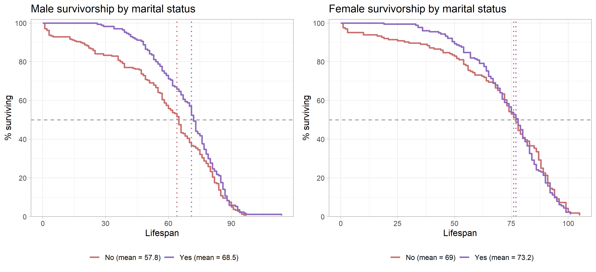

```{=latex}
\onecolumn
\begingroup
\thispagestyle{empty}
\sffamily

% Publication line and journal masthead
\noindent
\begin{minipage}[t]{0.66\linewidth}
  \scriptsize
  Drew. \textit{Survivorship Curves of Sunset Hill Cemetery}
  \hfill (2026) 1:1\\
  Valdosta State University, Ecology and Evolution
\end{minipage}
\hfill
\begin{minipage}[t]{0.30\linewidth}
  \raggedleft
  \large Cemetery Demography\\[-2pt]
  \large BIOL 3250
\end{minipage}

\vspace{0.28in}

% Article-type band
\noindent
\colorbox{reportred}{%
  \parbox{\dimexpr\linewidth-2\fboxsep\relax}{%
    \color{white}
    \textbf{RESEARCH ARTICLE}\hfill
    \textbf{CLASS PROJECT}
  }%
}

\vspace{0.18in}

% Title and author line
\noindent
{\fontsize{23}{27}\selectfont
\textbf{Lifespan is Effected by Military Survice}\par}

\vspace{0.12in}

\noindent
{\small
Jonah Ethan Drew\textsuperscript{1,*}
}

\vspace{0.08in}

% Structured abstract
\setlength{\fboxsep}{6pt}
\noindent
\fcolorbox{reportred}{white}{%
  \begin{minipage}{\dimexpr\linewidth-2\fboxsep-2\fboxrule\relax}
    \small

    \textbf{Abstract}

    \vspace{3pt}

    \textbf{Purpose:}
    This project describes the lifespan in cemetery records and examines the
    variation by military service. 

    \vspace{3pt}

    \textbf{Methods:}
    Recorded available birth and death information from gravestones
    and classified the military status of males using the visible evidence on the
    gravestones. Each name was recorded along with the date of thier birth, the date of their death, their gender, and if they served in the military.

    \vspace{3pt}

    \textbf{Results:}
    I have concluded that, on average, males enlisted in the military generally had longer lifespans than males who were not enlisted in the military. 

    \vspace{3pt}

    \textbf{Conclusions:}
    The observed pattern of this sample suggests that military service increases lifespan on average, but this could potentially be limited due to the fact that most of the servicemen buried here simply were the ones who survived the wars they fought in and lived normal lives afterwards. 

    \vspace{3pt}

    \textbf{Keywords:}
    cemetery records; lifespan; survivorship; historical demography; military status
  \end{minipage}%
}

% Bottom-page author and institutional details
\vfill

\noindent\rule{0.56\linewidth}{0.4pt}

\vspace{3pt}

\noindent
{\scriptsize
\textsuperscript{*}Correspondence: bhendrickson@valdosta.edu\\
\textsuperscript{1}Department of Biology, Valdosta State University,
Valdosta, Georgia, USA\\
Ecology and Evolution, BIOL 3250, Section B
}

\vspace{0.10in}

\noindent
\begin{minipage}[c]{0.20\linewidth}
  \includegraphics[width=0.72in]{Valdosta_State_University_seal.png}
\end{minipage}
\endgroup
\twocolumn
```

# Background

Cemetery records provide individual birth and death dates that can be used to describe lifespan among people represented in a burial ground. These records are a non-random sample: cemetery access, preservation of markers, migration, family burial practices, and the choice of graves to record may all affect which people appear in the dataset. The analyses below therefore describe the collected sample and should not be treated as direct estimates of lifespan for an entire town or historical population.

# Hypotheses

**Military service and lifespan:** I hypothesize that male records marked as military service will show lower lifespan than records not marked for service because of drafting, exposure to chemical agents, and the dangers associated with military lifestyle.

# Methods


## Field site and sampling

- **Where did you go?** We went to the Sunset Hills Cemetary in Valdosta, Georgia located next to the VSU campus. I stayed around the eastern end of the cemetary and wrote down the information on the headstones.
- **What date and time of day did you collect records?** We went on Thursday October 8th, 2026, from around 2:15 PM to around 3:00 PM.
- **What part of the cemetery did you sample?** I entered around the southestern end and stayed around the eastern to northeastern part of the cemetary. 
- **How did you choose graves?** I chose gravestones at random initially, but then went along down the rows, only skipping over the gravestones that were illegible or had no data on them. 
- **How did you handle nearby graves and family plots?** I wrote down names next to each other if they were part of the same family, keeping them together before moving onto another last name. 

## Recorded information and variable definitions

- **What information did you record from each marker?** I recorded names, birth date, death date, gender, and military status. 
- **How was lifespan calculated?** I calculated the lifespan by subtracting the death year by the birth year and then determined if they passed before or after their birthday within the year. 
- **How did you determine marital status?** I did not record marital status in my data due to being unable to determine from the data the gravestones provided. 
- **How did you determine military service?** The gravestones stated whether or not the deceased individual was a veteran along with their rank. Those that didn't state the individual was a veteran, I assumed they were not in the military. 
- **How did you determine sex or gender?** I determined the gender of the individual based on their names and if they had a masculine or feminine name. 
- **How were missing, illegible, or ambiguous records handled?** I skipped over the greavestones with illegible or missing data and did not record them. 

## Dataset and analysis

- **How many records were collected by you?** n = 25 
- **How many records were included in the final analysis?** n = 702 
- **Were records aggregated with the class dataset?** Yes. I noticed some duplicates involved in the data because there were many students involved in collecting the data, so some graves were accidentally repeated. 
- **What summaries or plots were produced?** The plot which was produced showed a fairly similar result between males that had joined the military and males that did not join the military, the left part of the plot showing military males had higher survival chances which began to fluctuate as the ages increased. 
- **What are the limits of the sample?** One of the main limitations of the sample is the minimum age of military service being 18, meaning that there are no military males which passed before their 18th birthday, increasing the mean age of military males compared to non-military males. Another limitation is that most of the servicemen buried in this cemetary survived the war and lived normal lives, whereas most of the serviemen who were killed on duty were buried in the Arlington National Cemetary. 

# Results

**Replace each image placeholder with a PNG of the matching plot from the final class dataset. Keep figures in the `survivorship_curves` and `cemetery_lifespan_report_files` folder, or update the image path in the Markdown. The figure captions are editable and should describe the plotted groups, axes, and relevant reference lines.**

**Summarize the data both by referencing @fig-summary and by writing out what the table is displaying specific to your particular research hypothesis. For instance, if you are interested only in marriage status and sex, then report the mean and standard deviation of males and females that are married vs unmarried; you do not need to discuss military status unless this is part of your research question/hypothesis.**

*The summary table in @fig-summary shows substantial differences in recorded lifespan by sex in this sample. Males had a mean lifespan of 59.0 years (SD = 20.4; n = 3), compared with 29.7 years (SD = 7.1; n = 3) for females. The marital-status breakdown is more tentative because each subgroup contains only one or two records. Among males, the two married individuals had a mean lifespan of 70.5 years (SD = 6.4), while the one unmarried individual lived 36 years. Among females, the one married individual lived 36 years, compared with a mean of 26.5 years (SD = 6.4) for the two unmarried individuals. These small subgroup sizes make the values descriptive; they do not support broad conclusions about sex or marital status.*

{#fig-summary width=90% fig-pos="t" fig-env="figure*"}

*The sex-specific survivorship curves in @fig-sex show a different pattern: the plotted means are 61.1 years for males and 57.3 years for females. The male curve remains higher through much of the earlier and middle lifespan, while the female curve reaches the 50% survival point later. The curves are close and change relative position, so the figure suggests that the sex difference depends on which part of the lifespan distribution is considered. The median markers indicate where each group’s observed curve reaches 50% surviving; they are distinct from the mean values shown in the legend.*

{#fig-sex width=70% fig-pos="t" fig-env="figure*"}

*The within-sex comparisons in @fig-married show higher plotted mean lifespans for married than unmarried individuals in both panels. For males, the plotted means are 64.3 years for married individuals and 55.4 years for unmarried individuals. For females, they are 64.3 and 46.3 years, respectively. The curves also place the 50% survival point later for the married groups. These are descriptive differences and should not be interpreted as evidence that marriage caused longer lifespan; other factors and the sizes and composition of the groups could contribute.*

{#fig-married width=70% fig-pos="t" fig-env="figure*"}

**Summary of observed results:** Overall, the average age of deaths from males in the military was greater than males not in the military. In total, there were fewer males in the military than males not in the military, descreasing the sample size of military males.

# Discussion

Write a paragraph or two, citing your sources to prove the results of your data.
**Veteran status and lifespan.** Research on this data would seem to point towards men in the military having a longer average lifespan than men who did not serve in the military. In this cemetery sample, the observed curves for males who served or didn't were fairly similar with the lines fluctuating between each other and do not support the prediction that males in the military live shorter lives on average compared to males who did not serve in the military.

**Limitations and next steps:** The limitations which gave these results are likely due to most of these men surviving the wars they served in, most of the fallen soldiers being buried elsewhere, and a smaller sample size compared to the overall amount of males in the study.

```{=latex}
\newpage
```

### References

::: {#refs} 
::: 
